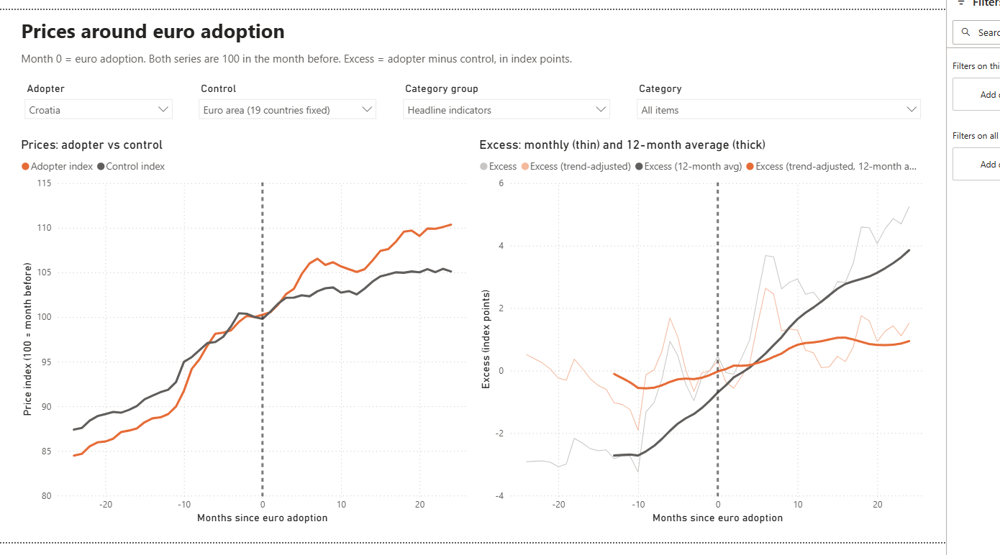

# Je li uvođenje eura podiglo cijene u Hrvatskoj?

[🇬🇧 English](README.md) | 🇭🇷 Hrvatski

Projekt sam napravio prvenstveno kao vježbu za Power BI, SQL i Python. Temu sam izabrao kao test
svoje naivnosti - vjerovao sam da cijene neće rasti značajno isključivo zbog uvođenja eura.

Zanimalo me koliko je rast cijena u Hrvatskoj bio posljedica uvođenja eura, a koliko rezultat općenite
inflacije. Zato sam ga usporedio s rastom cijena u eurozoni, ali i u sličnim zemljama koje nisu uvele euro.
Kao dodatni zadatak, isto sam napravio i za 5 ostalih država koje su uvele euro od 2007.

Za Hrvatsku, kod dobara možda i nisam bio tako naivan - u usporedbi s eurozonom vidi se mali porast (oko 1,5
postotnog boda), koji bi mogao biti i posljedica toga što Hrvatska sustiže razvijenije zemlje, pa joj plaće i
cijene rastu brže. U usporedbi sa sličnim zemljama bez eura tog porasta nema. Kod usluga je efekt oko 2 postotna
boda, ali s dosta nesigurnosti - ovisno o usporedbi i promatranom razdoblju kreće se od 0 do 2,5, jer je euro
uveden usred inflacijskog vala 2022.

Gledajući svih šest zemalja, slika je jasnija: kod dobara nema statistički značajnog efekta, a usluge su u prvoj
godini eura poskupjele oko 1,5 postotnog boda više od usporednih zemalja.

U izvještaju se rast cijena rastavlja na tri dijela: koliko su cijene porasle u usporednim zemljama u
isto vrijeme (opća inflacija), koliko je Hrvatska ionako rasla brže i prije eura, te ono što ostaje -
procjena efekta eura.

Kod usluga se efekt najjasnije vidi tamo gdje se plaća sitno i često: restorani i kafići, menze, frizeri,
rekreacija i sport te popravci kućanskih aparata. Te usluge poskupjele su više nego u usporednim zemljama u
gotovo svih šest zemalja, u prosjeku za 2 do 3 postotna boda. Kod telekomunikacija (mobitel, internet), gdje cijene
određuju velike tvrtke, efekta nema.

Usput sam nekoliko puta morao korigirati zaključak. U usporedbi samo s eurozonom, na početku je izgledalo da su
usluge u Hrvatskoj zbog eura poskupjele čak 4 postotna boda više. Kad sam uzeo u obzir da je Hrvatska i prije eura rasla
brže od eurozone te dodao usporedbu sa sličnim zemljama bez eura, ta se brojka smanjila na oko 2 postotna boda.
Na kraju sam napravio i provjeru s "lažnim" datumima uvođenja eura, i za samu Hrvatsku efekt
je ispao na granici statističke značajnosti.

Kod sam pisao uz pomoć [Claude Codea](https://claude.com/claude-code).

Bugarska je uvela euro 2026., pa ću početkom 2027. provjeriti vrijedi li isto i za nju.

## Isprobaj izvještaj

Preuzmi `EuroPrices.pbix` (s podacima) iz
[zadnjeg izdanja](https://github.com/ivanbelak/euro-adoption-prices/releases/latest) i otvori ga u besplatnom
[Power BI Desktopu](https://www.microsoft.com/power-platform/products/power-bi/desktop) (Windows). Odabereš
zemlju, usporednu skupinu, kategoriju i vremenski prozor, a grafovi se prilagode. Izvještaj je na engleskom.

## Više detalja

Metoda, sve tablice s rezultatima, placebo test, napomene o kvaliteti podataka i kako sve ponovo izgraditi:
**[docs/METODOLOGIJA.md](docs/METODOLOGIJA.md)**.

Što je u repozitoriju:

- `src/` - Python: preuzimanje podataka s Eurostata i FRED-a, punjenje SQL Servera, logika placebo testa
- `sql/` - SQL Server: zvjezdasta shema, viewovi za event study i prethodne trendove
- `powerbi/` - Power BI izvještaj (format PBIP projekta)
- `notebooks/` - placebo test, s grafovima
