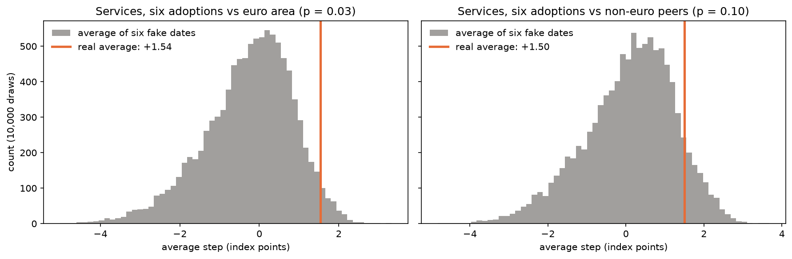

# Metodologija i detaljni rezultati

[← Natrag na README](../README.hr.md) · [🇬🇧 English](METHODOLOGY.md)

## Pitanje

Hrvatska je uvela euro 1. siječnja 2023. Od prosinca 2022. do kolovoza 2026. potrošačke cijene u Hrvatskoj
porasle su **19,0 %**, a u europodručju **10,7 %** (EA19, bez Hrvatske). No i u susjednim zemljama koje nisu
uvele euro, poput Mađarske i Poljske, cijene su porasle oko 16 %. Koliko je od toga zbog eura, a koliko zbog
svega ostalog?

Projekt na to pokušava odgovoriti službenim podacima Eurostata. Svaka zemlja koja je uvela euro od 2007.
(Slovenija, Slovačka, Estonija, Latvija, Litva, Hrvatska i, od 2026., Bugarska) uspoređuje se s dvije vrste
kontrolnih skupina koje u isto vrijeme **nisu** mijenjale valutu:
- **europodručje** (EA19, fiksni sastav od 19 zemalja, bez Hrvatske i Bugarske),
- **susjedne zemlje bez eura**: Mađarska, Poljska, Češka i Rumunjska, svaka posebno i njihov prosjek.

SAD (indeks potrošačkih cijena s FRED-a) služi samo kao globalni kontekst.

## Rezultati

**Ukratko:** u svih šest zemalja za koje postoji barem godina podataka nakon uvođenja eura, **usluge** su u prvoj
godini eura poskupjele više nego u kontrolnim skupinama, i to otprilike 0,3 do 3,4 boda indeksa nakon
uklanjanja prethodnog trenda. U prosjeku svih šest zemalja to je oko **+1,5 boda, više nego što pokaže 97 %
"lažnih" datuma uvođenja** u odnosu na europodručje (90 % u odnosu na susjede bez eura). Kod **dobara** i
**ukupnih cijena** nema ničeg većeg od šuma. Za **samu Hrvatsku** smjer se poklapa, ali je dokaz na granici,
a veličina se kreće od oko +0,3 do +4 boda, ovisno o kontrolnoj skupini i načinu mjerenja trenda prije eura.

### Metoda

1. **Poravnanje:** svaka zemlja se poravna na vlastiti mjesec uvođenja eura (mjesec 0), a cijene se postave
   na 100 u mjesecu prije.
2. **Usporedba:** s kontrolom u istim kalendarskim mjesecima, postavljenom na isti način.
   **Višak** (*excess*) = zemlja − kontrola, u bodovima indeksa. Šokovi koji pogađaju obje (energija, kamatne
   stope, rat) se poništavaju.
3. **Uklanjanje prethodnog trenda:** cijene u Hrvatskoj rasle su brže od europodručja već prije 2023.
   (gospodarstvo koje sustiže razvijenije zemlje, s brzim rastom plaća). Kroz višak u zadnjih 12/24/36/48
   mjeseci prije eura provuče se pravac i produži iza mjeseca 0; računa se samo višak *iznad* tog pravca.
4. **Izglađivanje turističke sezone:** usluge u Hrvatskoj poskupe svako ljeto, pa glavni broj uspoređuje
   prosječni višak u prvoj godini eura (mjeseci 0–11) s godinom prije (mjeseci −12 do −1).

### Usluge: efekt eura po zemlji i kontroli

Promjena viška nakon uklanjanja trenda, prva godina eura u odnosu na godinu prije (bodovi indeksa, prozor
trenda 24 mjeseca):

| Zemlja (godina) | u odnosu na europodručje (EA19) | u odnosu na susjede bez eura (prosjek) |
|---|---|---|
| Latvija (2014.) | +2,5 | +2,6 |
| Estonija (2011.) | +2,4 | +3,4 |
| Hrvatska (2023.) | +1,8 | +0,3 |
| Litva (2015.) | +1,2 | +1,5 |
| Slovenija (2007.) | +0,9 | +0,9 |
| Slovačka (2009.) | +0,5 | +0,4 |

- **Pozitivno u svih dvanaest slučajeva.** To se uklapa u priču o zaokruživanju: jeftine usluge koje se
  često plaćaju (kava, frizer, popravci), a prodaju ih mali obrti, mjesto su gdje je cijenu najlakše
  zaokružiti naviše. Dobra koja prodaju veliki trgovački lanci na konkurentnom tržištu nisu. U odnosu na
  susjede kod dobara je slika miješana (−2,6 do +1,4), pa dobra služe kao provjera, a ne kao nalaz.
- **Oblik je stepenica, a ne nagib.** Nakon uklanjanja starog trenda višak raste tijekom prve godine, a zatim
  ostaje ravan: jednokratna promjena razine pri prelasku na euro, a ne trajno brža inflacija.
- **Dvije vrlo različite kontrole se slažu.** Europodručje raste sporije od Hrvatske, a susjedi brže i imali
  su vlastite šokove (Mađarska je početkom 2023. imala inflaciju od oko 25 %). Prije uklanjanja trenda višak
  usluga u Hrvatskoj bio je +4,1 u odnosu na europodručje i −1,3 u odnosu na susjede. Nakon uklanjanja obje
  kontrole za većinu zemalja daju sličan odgovor.

### Koje usluge?

Isti izračun za svaku kategoriju usluga koja ima podatke za barem pet od šest zemalja (prozor trenda
24 mjeseca). "Više u" broji zemlje u kojima je kategorija poskupjela više nego u kontroli.

| Usluga | u odnosu na europodručje: više u | prosjek | u odnosu na susjede bez eura: više u | prosjek |
|---|---|---|---|---|
| Restorani, kafići | 6 od 6 | +2,6 | 5 od 6 | +2,7 |
| Menze i kantine | 6 od 6 | +3,5 | 5 od 6 | +3,2 |
| Rekreacija i osobna njega (ukupno) | 6 od 6 | +2,3 | 6 od 6 | +2,2 |
| Frizeri i kozmetičari | 6 od 6 | +2,2 | 4 od 6 | +2,0 |
| Popravci kućanskih aparata | 6 od 6 | +2,5 | 4 od 6 | +2,2 |
| Sport i rekreacija | 5 od 6 | +2,7 | 5 od 6 | +2,2 |
| Stomatološke usluge | 5 od 6 | +1,8 | 5 od 6 | +1,5 |
| *za usporedbu:* | | | | |
| Mobilna telefonija | 4 od 6 | −0,3 | 3 od 6 | −1,1 |
| Pristup internetu | 3 od 5 | −5,2 | 0 od 5 | −5,6 |
| Željeznički prijevoz | 1 od 6 | −0,9 | 4 od 6 | −0,1 |

Efekt je najjasniji tamo gdje se plaća sitno i često, a usluge pružaju mali obrti; nema ga tamo gdje cijene
određuju velike tvrtke ili država. Avionske karte imaju najveći prosjek, ali jako skaču (za Hrvatsku +39 u
odnosu na europodručje), pa su izostavljene kao šum. Tablica je opisna: kad se odjednom uspoređuje ~40
kategorija usluga, neke će slučajno izgledati velike, a placebo test po kategorijama nije rađen. Zato je broj
zemalja bolje mjerilo od prosjeka.

### Je li to više od šuma? Placebo test

Svaka metoda primijenjena na "bučne" mjesečne podatke izbaci *neki* broj. Da bi se taj šum izmjerio, isti
izračun pokreće se za **lažne datume uvođenja eura**: svaki mjesec od 18 do 240 mjeseci prije pravog, koliko
god podaci sežu. Razmak od 18 mjeseci drži lažnu "godinu nakon" podalje od mjeseci kad su cijene već bile
istaknute u eurima. Vidi [`notebooks/01_placebo_test.ipynb`](../notebooks/01_placebo_test.ipynb) (na engleskom).

Zemlja po zemlja test je slab (lažne procjene za Latviju kreću se od −10 do +6, kroz krizu 2008.–2010.).
Kad se usrednji šest zemalja, šum se djelomično poništi, a pravi efekt prelaska na euro ne bi smio:

| Prosjek šest zemalja | Pravi | 90 % lažnih prosjeka | p |
|---|---|---|---|
| Usluge u odnosu na europodručje | **+1,54** | −2,31 do +1,36 | **0,03** |
| Usluge u odnosu na susjede bez eura | **+1,50** | −2,01 do +1,84 | 0,10 |
| Dobra u odnosu na europodručje | +0,91 | −1,74 do +1,28 | 0,12 |
| Dobra u odnosu na susjede bez eura | −0,48 | −1,79 do +1,71 | 0,69 |
| Ukupne cijene u odnosu na europodručje | +0,86 | −1,82 do +1,38 | 0,14 |
| Ukupne cijene u odnosu na susjede bez eura | +0,13 | −1,96 do +1,55 | 0,44 |

p = udio lažnih prosjeka koji su jednaki pravom ili veći od njega (10.000 nasumičnih izvlačenja po jednog
lažnog datuma za svaku zemlju).



Sama Hrvatska: usluge +1,8 u odnosu na europodručje (p ≈ 0,07) i +0,3 u odnosu na susjede (p ≈ 0,37).
Susjedni lažni datumi dijele većinu podataka, pa su p-vrijednosti okvirne, a ne egzaktne.

### Zašto je Hrvatska najteži slučaj

Usluge u Hrvatskoj, promjena viška u odnosu na EA19 prema **prozoru trenda** (iz koliko mjeseci prije eura se
računa trend):

| Prozor trenda | ±12 | ±24 | ±36 | ±48 |
|---|---|---|---|---|
| Trend prije eura (bodova godišnje) | 6,7 | 3,2 | 1,9 | 1,1 |
| Efekt eura na usluge | −1,6 | +1,8 | +3,2 | +4,0 |

- Hrvatska je uvela euro na vrhuncu inflacijskog vala. Kratki prozor vidi samo ubrzanje iz 2022. i smatra ga
  "normalnim" trendom, koji onda proguta cijeli efekt; dugi prozor seže do mirnijih godina (i do COVID-a 2020.).
  Rezultati za Baltik i Sloveniju mijenjaju se puno manje.
- **Efekt najave.** Tečaj konverzije fiksiran je u srpnju 2022., a dvojno iskazivanje cijena (kune i euri)
  bilo je obavezno od rujna 2022., četiri mjeseca prije prelaska. Dio zaokruživanja vjerojatno se dogodio prije
  mjeseca 0, unutar razdoblja iz kojeg se računa trend, pa bi ove procjene mogle biti *preniske*.
- Prozor ±12 obuhvaća samo jednu turističku sezonu i najmanje je pouzdan od četiri.

### Pojedinačne kategorije prvo trebaju objašnjenje

Najveći viškovi u Hrvatskoj nisu efekt eura: javni prijevoz (+16,6 u odnosu na EA19, godinu dana nakon)
posljedica je njemačke karte od 49 € (Deutschlandticket, svibanj 2023.), koja je spustila indeks
europodručja, a struja i plin posljedica su hrvatskih ograničenja cijena. Kad se odjednom uspoređuje ~140
kategorija, neke će i slučajno izgledati velike; zato se analiza oslanja na usluge u cjelini, koje je teorija
predvidjela unaprijed.

## Power BI izvještaj

[`powerbi/EuroPrices.pbip`](../powerbi/) (format Power BI Project: model je u TMDL-u, a izvještaj u PBIR-u, pa su
oboje običan tekst koji git uredno prati). Pet stranica (na engleskom):

| Stranica | Pitanje |
|---|---|
| **Start here** | Što se uspoređuje, što pokazuje koja stranica, kako čitati filtere |
| **Croatia vs control** | Što se dogodilo s cijenama oko uvođenja eura, za jednu zemlju u odnosu na jednu kontrolu? |
| **All adopters** | Ponavlja li se isti obrazac kod svake zemlje? (mali grafovi po zemljama) |
| **Robustness** | Vrijedi li rezultat i uz drugu kontrolu? (matrica zemlja × kontrola) |
| **Croatia by category** | Koje su cijene najviše "pobjegle" i koje od njih su lažni alarmi? |

Sliceri biraju zemlju, kontrolu, **prozor trenda** (±12 do ±48 mjeseci) i kategoriju (ukupne cijene, temeljna
inflacija, usluge, dobra, hrana, energija, neenergetska industrijska dobra); zadnja stranica ide do ~140
detaljnih kategorija. Mjere su DAX koji prati odabrani prozor (`SELECTEDVALUE`, `CALCULATE`, `AVERAGEX`), s
12-mjesečnim pomičnim prosjecima za uklanjanje sezonalnosti, i uvijek računaju točno jednu kategoriju.

**Isprobaj bez baze:** preuzmi `EuroPrices.pbix` (s podacima) iz
[zadnjeg izdanja](https://github.com/ivanbelak/euro-adoption-prices/releases/latest) i otvori ga u besplatnom
[Power BI Desktopu](https://www.microsoft.com/power-platform/products/power-bi/desktop) (Windows).
Datoteke u mapi `powerbi/` sadrže samo izvještaj i model; s njima prvo treba izgraditi bazu (vidi *Pokretanje*)
i kliknuti **Refresh**.

## Tijek podataka

```
Eurostat (HICP)  ─┐
                  ├─ Python ─→ SQL Server ─────────────────────────→ Power BI
FRED (US CPI)   ──┘            stg  →  dim / fact  →  pbi views
                               bronze   silver        gold
                                            └─→ qa provjere
```

Baza prati raspored u stilu *medallion* arhitekture: `stg` sadrži sirove podatke kako su učitani (bronze),
`dim`/`fact` očišćenu zvjezdastu shemu (silver), a `pbi` analitičke viewove koje čita izvještaj (gold).

| Korak | Što | Gdje |
|---|---|---|
| Dohvat | Cijeli Eurostatov skup `prc_hicp_minr` (46 zemalja, 555 kategorija, 1996.–2026.) preko Eurostatova API-ja; US CPI s FRED-a | [`src/fetch_eurostat.py`](../src/fetch_eurostat.py), [`src/fetch_fred.py`](../src/fetch_fred.py) |
| Učitavanje | Staging i dimenzijske tablice, ~5,5 mil. redaka za ~30 s | [`src/load_sql.py`](../src/load_sql.py) |
| Transformacija | Zvjezdasta shema u SQL-u: pivotiranje mjera, kalendar, hijerarhija kategorija | [`sql/01`–`04`](../sql/) |
| Provjera | Inflacija izračunata iz indeksa uspoređuje se s onom koju objavljuje Eurostat | [`sql/04_views.sql`](../sql/04_views.sql) (`qa.yoy_check`) |
| Event study | Poravnanje zemalja, postavljanje na 100, sparivanje sa svakom kontrolom (CTE-ovi, window funkcije, `CROSS JOIN`) | [`sql/05_event_study.sql`](../sql/05_event_study.sql) |
| Prethodni trendovi | OLS nagib viška prije eura za četiri prozora; višak bez trenda | [`sql/07_pre_trends.sql`](../sql/07_pre_trends.sql) |
| Istraživanje | Upiti iza gornjih nalaza | [`sql/06_event_study_findings.sql`](../sql/06_event_study_findings.sql) |
| Placebo test | Event study u pandasu za bilo koji datum, pokrenut za svaki lažni datum koji podaci dopuštaju (38 do 223 po zemlji); poklapa se sa SQL viewovima do 1e-14 | [`src/event_study.py`](../src/event_study.py), [`notebooks/01_placebo_test.ipynb`](../notebooks/01_placebo_test.ipynb) |

## Kvaliteta podataka

- **Provjera u odnosu na izvor.** Inflacija izračunata iz indeksa poklapa se s Eurostatovom unutar 1 postotnog
  boda u svim osim 112 od 1,77 milijuna točaka, uglavnom za Rumunjsku 1997.–1999. (zaokruživanje pri vrlo
  visokoj inflaciji).
- **Promjena klasifikacije.** Eurostat je 2026. prebacio HICP na **ECOICOP ver.2**; stari skupovi
  (`prc_hicp_manr`, `prc_hicp_midx`) tiho staju na prosincu 2025. Projekt koristi `prc_hicp_minr`.
- **Indeksi koji su točno 0.** Neki su stvarni (Bugarska je od travnja 2022. ukinula plaćanje vrtića; javni
  prijevoz u Estoniji pao je na 0 u lockdownu 2020.), a neki izgledaju kao rupe u podacima (pretplate na
  streaming u Rumunjskoj, 2018.–2023.). Rast od nule nije definiran, pa je svako dijeljenje zaštićeno s
  `NULLIF`, a ti retci nemaju višak.
- **Zaokruživanje.** Objavljeni indeksi imaju dvije decimale, pa prosjek 2015. ispadne npr. 99,998, a ne 100.
- **Neujednačena pokrivenost.** Najdetaljnije kategorije (npr. "kava") kod većine kontrola počinju tek
  2014.–2016., pa za Sloveniju, Slovačku i Latviju oko polovine tih redaka nema višak. Usporedbe među
  zemljama zato koriste COICOP razine 1–3 i Eurostatove agregate, gdje je pokrivenost veća od 94 %.
- **Mjerilo fiksnog sastava.** Serija europodručja `EA` mijenja članstvo i od 2023. uključuje Hrvatsku, pa
  usporedbe koriste `EA19`. EA19 ipak sadrži i ranije zemlje koje su uvele euro, svaku s težinom od oko 1 %
  ili manje, što njihov višak malo umanjuje.

## Pokretanje

Potrebni su [conda](https://docs.conda.io/) i SQL Server (dovoljan je Express) s ODBC Driverom 18.

```bash
conda env create -f environment.yml
conda activate euro-cijene
python src/fetch_eurostat.py
python src/fetch_fred.py
python src/load_sql.py        # postavi SQL_SERVER=... ako nije localhost
pytest
python notebooks/build_placebo_notebook.py   # ponovo izvršava notebook s placebo testom
```

Zatim otvori `powerbi/EuroPrices.pbip` u Power BI Desktopu i klikni **Refresh** (server i baza su Power Query
parametri `SQL Server` i `SQL Database`).

## Izvori podataka

- **Eurostat**, harmonizirani indeks potrošačkih cijena, skup
  [`prc_hicp_minr`](https://ec.europa.eu/eurostat/databrowser/view/prc_hicp_minr/default/table) (© Europska unija,
  ponovna uporaba prema Eurostatovim pravilima o autorskim pravima).
- **U.S. Bureau of Labor Statistics**, indeks potrošačkih cijena za gradsko stanovništvo, bez sezonske
  prilagodbe ([`CPIAUCNS`](https://fred.stlouisfed.org/series/CPIAUCNS), preko FRED-a).
